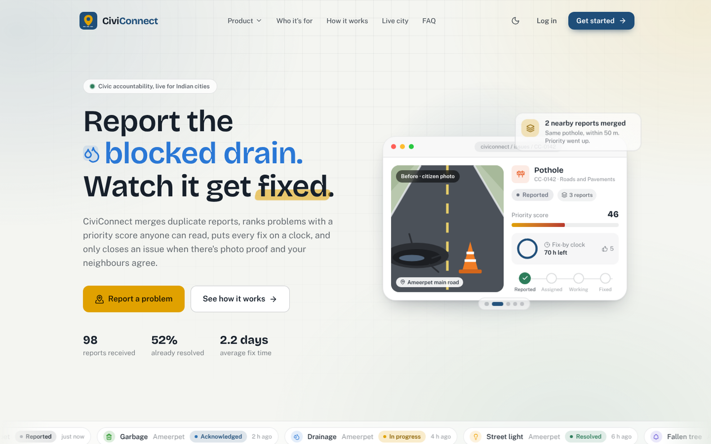
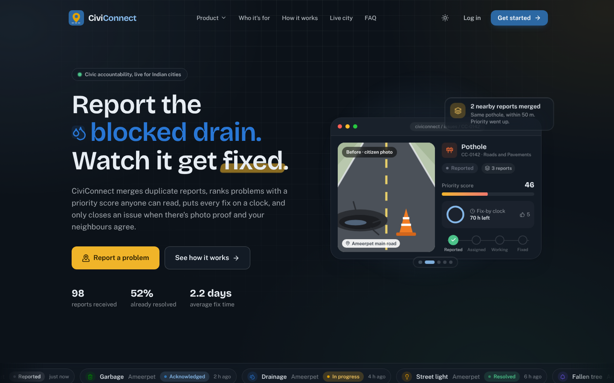
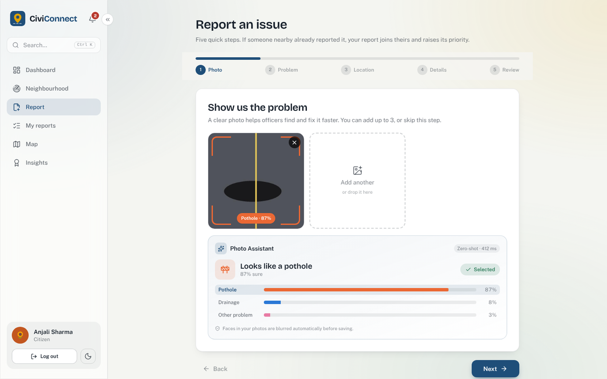
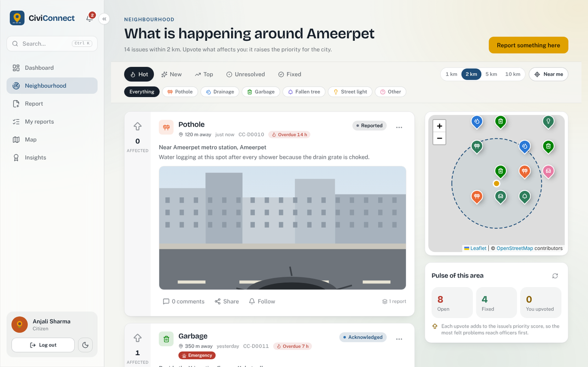
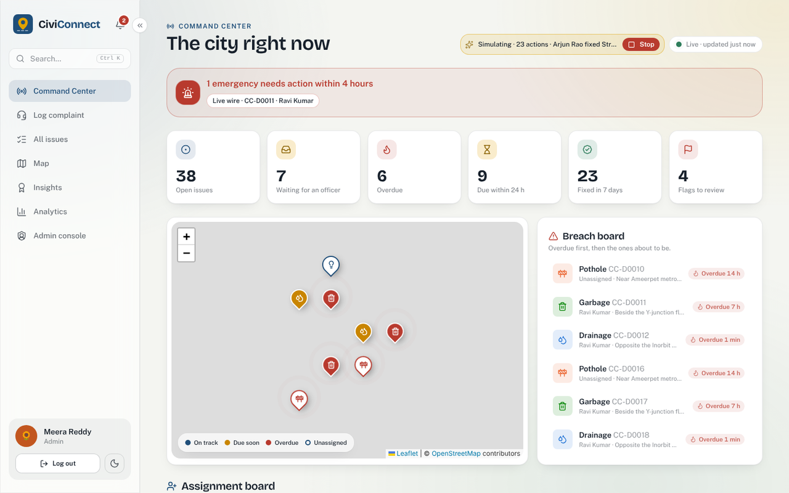
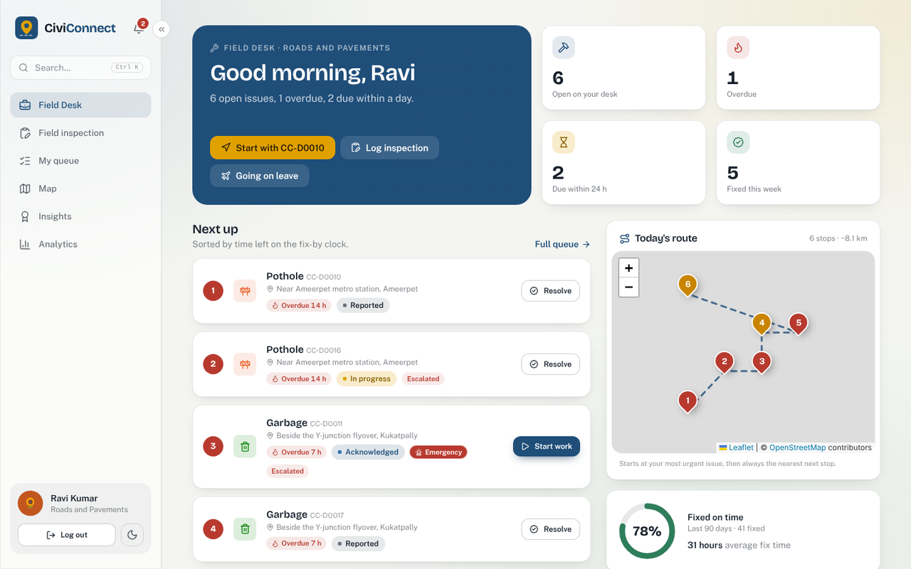
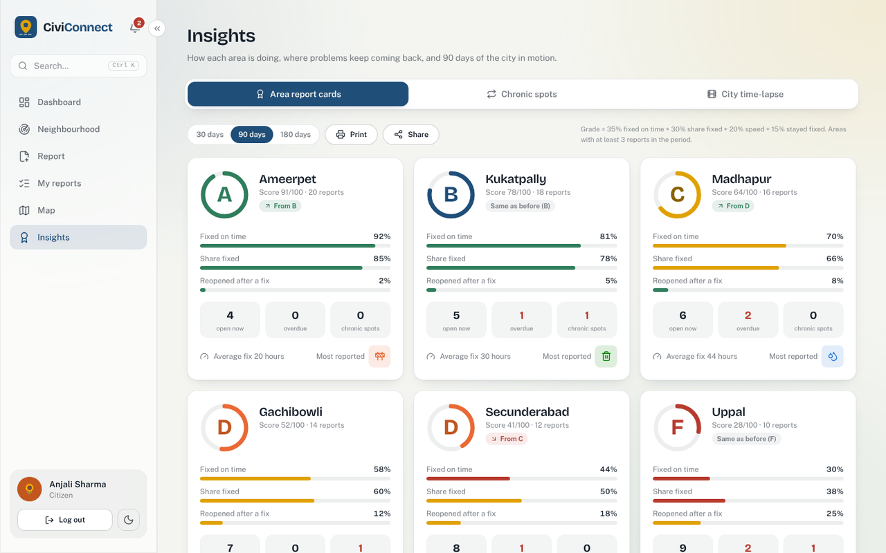

<div align="center">

# 🏙️ CiviConnect

**Report it. Watch it get fixed. Confirm it's gone.**

Crowdsourced civic issue reporting and resolution for Indian cities: potholes, blocked drains, garbage,
fallen trees and broken street lights, from a citizen's photo to a verified fix.


🎓 Final-year B.Tech project

</div>

---

## 📸 Screenshots

> 💡 To use your own screenshots, save a PNG in `docs/screenshots/` with the same file name and it replaces the one below.

| 🏠 Landing page | 🌙 Dark mode |
|---|---|
|  |  |
| 📷 **Report wizard + Photo Assistant** | 📍 **Neighbourhood feed** |
|  |  |
| 🛰️ **Command Center (admin)** | 🧰 **Field Desk (officer)** |
|  |  |
| 🏆 **Area report cards** | |
|  | |

<!-- After training the model (Phase 10b), add a screenshot of Admin > Photo Assistant as
     docs/screenshots/admin-photo-assistant.png and add it to the table above. -->

---

## ✨ Features

### 👩‍💼 Citizens
- 📝 **5-step report wizard:** photo, problem, location (search, GPS or map), details, review
- 🖱️ Add photos by tapping, **dragging them onto the page**, or **pasting with Ctrl+V**
- 🤖 **Photo Assistant:** suggests the category from the photo and warns about blurry, dark or non-civic photos
- 🙈 **Privacy blur:** faces in uploaded photos are blurred automatically before saving
- 🚨 **Emergency reports:** live wire, open manhole, flooding… 4-hour fix-by time and admins alerted at once
- 🔗 **Duplicate merging** within 50 m, with "similar issues nearby" shown before submitting
- 📍 **Neighbourhood feed** (2 km) with Hot / New / Top sort; upvote, follow, hide, flag, discuss
- 🔔 Live status tracker, real-time notifications, before/after photos, **verify the fix or reopen it**
- 🏅 Civic score, badges and levels; shareable public issue page without names
- 🔑 **Forgot password** by email (on a laptop without email, the link appears on screen)

### 🧰 Field officers
- 📋 **Field Desk:** queue sorted by time left, today's route (nearest stop next), on-time rate
- 🔍 Log problems found during field inspections; resolve with a proof photo
- ✈️ **On leave:** open work is handed to colleagues automatically; nothing new is assigned until they're back, and on return anything not yet started comes back to them

### 🛰️ City admins
- 🗺️ **Command Center:** emergency banner, live map, overdue board, unassigned queue with smart officer suggestions, officer lanes
- ☎️ Register complaints for citizens who phone, walk in or write
- 🛠️ **Admin console:** people and roles, leave, moderation queue, SLA hours per category, audit log, Photo Assistant model card
- 📊 Analytics with CSV export, **area report cards (A to F)**, chronic-spot detection, 90-day city time-lapse, live demo simulator

### ⚙️ Platform
- 🧮 **Priority score out of 100:** category hazard, extra reports, supporters, days open, +15 if overdue, +25 for an emergency
- ⏱️ **SLA engine:** a sweep every minute warns at 25% time left, escalates overdue issues and ends expired leave
- ⚡ Server-Sent Events for live updates · 🌍 MongoDB 2dsphere geospatial queries · 📄 server-side pagination
- 🎨 SaaS-style landing page with live public statistics, light and dark themes, works on phones, Ctrl+K command palette

---

## 🏗️ Architecture

```
client/  React 19 + TypeScript + Vite + Tailwind v4 + Leaflet + Recharts      (port 5173)
   |  /api (Vite proxy in development)
server/  Express 5 + TypeScript + Mongoose + Zod + Nodemailer                 (port 5000)
   |-- MongoDB Atlas            data, 2dsphere index
   |-- Cloudinary               photo storage
   |-- OpenStreetMap Nominatim  address search (cached, throttled)
   |-- SMTP (optional)          password-reset emails
   '-- ml/ Photo Assistant      FastAPI + CLIP + YuNet, runs locally          (port 8000)
```

---

## 🧩 Requirements

- 🟢 Node.js 20 or newer
- 🍃 A MongoDB Atlas connection string
- ☁️ A Cloudinary account (only for photo uploads)
- 🐍 Python 3.10 to 3.14 (only for the Photo Assistant)

---

## 🚀 First-time setup

### 1️⃣ Server
1. `cd server`
2. `npm install`
3. Copy `.env.example` to `.env` and fill it in (see the table below)
4. Optional demo city: `npm run seed:demo` (it prints the demo logins)

### 2️⃣ Client
1. `cd client`
2. `npm install`

### 3️⃣ Photo Assistant (optional, the app works without it)
1. `cd ml`
2. `python -m venv .venv`
3. Activate it in PowerShell:
   `Set-ExecutionPolicy -Scope Process -ExecutionPolicy RemoteSigned; .venv\Scripts\Activate.ps1`
   (Command Prompt: `.venv\Scripts\activate`; Mac/Linux: `source .venv/bin/activate`).
   The prompt now starts with `(.venv)`.
4. `pip install -r requirements.txt` (a few minutes, about 1 GB)

The first start downloads the CLIP model once (about 600 MB). After that it runs offline on the CPU.
No external AI API is used.

### 🔐 Server environment variables (`server/.env`)

| Name | Meaning |
|------|---------|
| `MONGODB_URI` | MongoDB Atlas connection string |
| `JWT_SECRET` | At least 32 random characters |
| `CLIENT_URL` | Usually `http://localhost:5173` |
| `CLOUDINARY_CLOUD_NAME`, `CLOUDINARY_API_KEY`, `CLOUDINARY_API_SECRET` | Photo uploads |
| `VISION_URL` | Photo Assistant address; leave empty for `http://localhost:8000` |
| `SMTP_HOST`, `SMTP_PORT`, `SMTP_USER`, `SMTP_PASS`, `MAIL_FROM` | Optional email for password resets. Leave empty and the reset link is printed in the server terminal and shown on screen |

⚠️ Never commit `.env`.

---

## ▶️ Running every day

Open three terminals in the project folder:

| Terminal | Commands | ✅ Ready when you see |
|----------|----------|--------------------|
| 🖥️ Server | `cd server` then `npm run dev` | `Server running` |
| 🌐 Client | `cd client` then `npm run dev` | a `localhost:5173` link |
| 🤖 Photo Assistant | `cd ml`, activate the venv (step 3 above), then `uvicorn app.main:app --port 8000` | `Photo Assistant ready` |

Open http://localhost:5173. The Photo Assistant terminal looks idle once it's ready; that's normal. Ctrl+C stops any of them.

---

## 🤖 Photo Assistant (computer vision)

- 🧠 **Model:** OpenAI CLIP ViT-B/32 through Hugging Face `transformers`. It turns a photo into 512 numbers (an embedding).
- 🎯 **Zero-shot mode (default):** the photo's embedding is compared with embeddings of written descriptions of every
  category (`ml/app/labels.py`), plus a "not a civic problem" class. No training data needed.
- 🏋️ **Trained mode:** when `ml/models/civic_head.npz` exists, a logistic-regression layer trained on labelled photos is
  used on top of the same embeddings (a "linear probe").
- 🙈 **Privacy blur:** YuNet, a small face detector from the OpenCV Model Zoo (`ml/assets/`), finds faces and pixelates them before the photo is stored.
- 🔎 **Quality checks:** blur (variance of the Laplacian), darkness, and phone photo rotation.
- 📏 **Measured in two ways:** accuracy on held-out test photos (from the notebook), and how often citizens kept the
  suggestion in real use (Admin › Photo Assistant).

### 🏋️ Training on your own photos (Google Colab, free)
1. 📁 In Google Drive create `civic_dataset/` with one folder per category: `pothole`, `drainage`, `garbage`,
   `fallen_tree`, `streetlight`, optional `other`, and `not_civic` (selfies, food, rooms, screenshots).
   Aim for 100 to 300 photos per folder.
2. 📓 Open `ml/notebooks/train_civic_classifier.ipynb` in Google Colab, choose a T4 GPU, and run all cells (about 10 minutes).
3. 📥 Put the two files it downloads, `civic_head.npz` and `metrics.json`, in `ml/models/` and restart the service.
   It now says `trained mode`, and Admin › Photo Assistant shows the test scores.

**API:** `GET /health` · `POST /classify` · `POST /privacy/blur` (multipart `image`, up to 8 MB).
Interactive docs at http://localhost:8000/docs while it runs.

---

## 🧪 Tests

| Part | Command | Covers |
|------|---------|--------|
| 🖥️ Server | `cd server` then `npm test` | priority formula, SLA and emergency clocks, leave routing, password-reset rules, email fallback, geo and text helpers, input validation, Photo Assistant client, login protection on every private route |
| 🤖 Photo Assistant | `cd ml`, activate the venv, then `python -m pytest -q` | API responses, bad uploads, blur/dark checks, decision thresholds, trained-model loading, face blurring |
| 🌐 Client | `cd client` then `npm run lint` and `npm run build` | type checking and lint rules |

---

## 🗂️ Folder structure

```
client/src/
  pages/         one file per screen (Landing, Dashboard, ReportIssue, CommandCenter, Admin, ...)
  components/    shared UI; components/landing/ holds the landing page sections
  lib/           API client, hooks, constants, formatting
server/src/
  models/        Mongoose schemas (Issue, User, Comment, Flag, Notification, AuditLog, CategoryConfig)
  controllers/   route handlers
  routes/        Express routers under /api
  services/      SLA engine, scheduler, notifications, routing, leave, mailer, insights, simulator, Photo Assistant client
  validators/    Zod schemas
server/test/     automated tests (node:test)
ml/
  app/           FastAPI service: labels, model, quality checks, privacy blur
  assets/        YuNet face-detection model (230 KB)
  notebooks/     Colab training notebook
  models/        trained classifier files (created by the notebook)
  tests/         pytest
docs/screenshots/  images used in this README
```

---

<div align="center">

Made with ☕ and a lot of potholes · Map data © <a href="https://www.openstreetmap.org/copyright">OpenStreetMap</a> contributors

</div>
